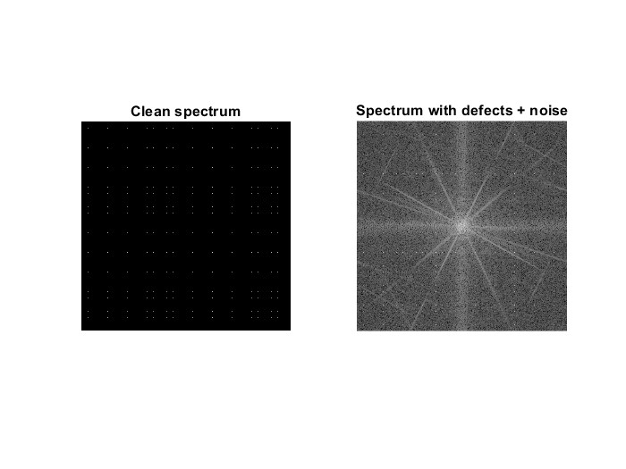
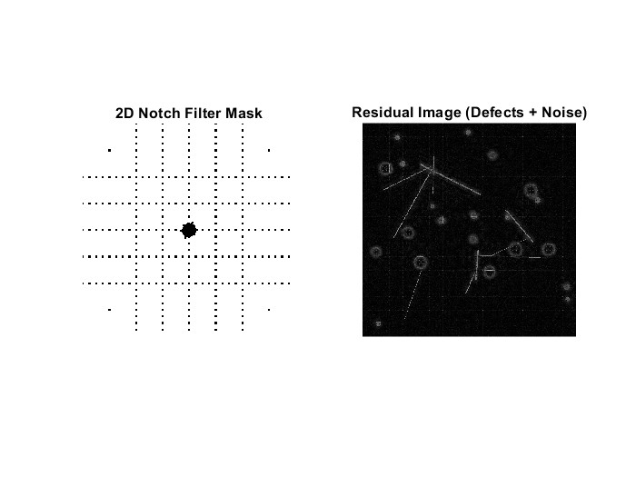
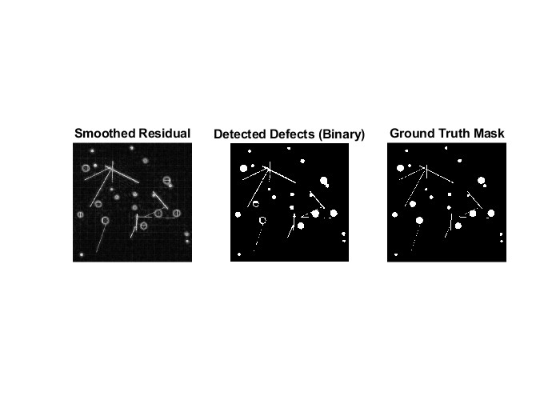
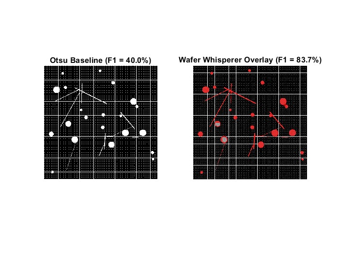

# Wafer Whisperer

Detection non-supervisee de defauts sur wafer de semi-conducteur, par filtrage FFT 2D.

Pas de deep learning, pas de dataset d'entrainement : on exploite la **periodicite** du motif du wafer pour isoler ce qui ne l'est pas (particules, rayures).

## Le probleme

Un wafer presente un motif tres regulier : grille de scribe + reseau de vias dans chaque die. Les defauts (contamination, rayures de manipulation) **brisent** cette periodicite.

Un seuillage classique (Otsu) confond la grille avec les defauts. On veut une methode qui connait la structure du fond.

## La methode

1. **Generation synthetique** d'un wafer + defauts (ground truth connue pour l'evaluation).
2. **FFT 2D** de l'image bruitee.
3. **Detection des pics** periodiques (seuil statistique sur le spectre).
4. **Notch filter** : on annule ces pics + leurs voisins (fuite spectrale) par dilatation morphologique.
5. **IFFT** : le residu contient defauts + bruit, plus la periodicite.
6. **Post-traitement spatial** : lissage gaussien, seuillage statistique, nettoyage morphologique.
7. **Evaluation** : precision / rappel / F1 contre la ground truth, compare a une baseline Otsu.

## Resultats

### 1. Spectres FFT : effet des defauts

A gauche le spectre du wafer propre (pics nets de la grille periodique), a droite le meme spectre une fois les defauts + bruit ajoutes : les defauts aperiodiques "etalent" l'energie partout.



### 2. Filtre notch 2D et image residuelle

Les pics de la grille sont detectes puis dilates, ce qui donne le masque notch (gauche). En retirant ces frequences du spectre et en reconstruisant, on obtient le residu (droite) ou seuls les defauts et le bruit subsistent.



### 3. Detection vs ground truth



### 4. Rapport final : Otsu vs Wafer Whisperer

| Methode         | Precision | Rappel  | F1-Score |
|-----------------|-----------|---------|----------|
| Otsu baseline   | 25.00%    | 100.00% | 40.00%   |
| Wafer Whisperer | 77.17%    | 91.36%  | **83.67%** |

Otsu detecte bien tous les defauts (rappel 100%) mais au prix d'enormes faux positifs (precision 25%) : il confond la grille avec des defauts. Le pipeline FFT gagne **+43 points de F1** en divisant les faux positifs par ~10, tout en gardant plus de 91% des vrais defauts.



## Lancer

Prerequis :
- MATLAB R2020b ou plus recent
- Image Processing Toolbox

```matlab
cd src
run wafer_whisperer.m
```

Le script genere le wafer, injecte les defauts, execute le pipeline FFT, et affiche toutes les figures intermediaires + le tableau de performance en console.

## Structure

```
src/                 code MATLAB
  wafer_whisperer.m  pipeline complet
figures/             PNG exportes pour le README
data/                datasets generes (gitignore)
doc/                 notes et figures pour le rapport
```

## Pistes d'amelioration

- Moyenner les metriques sur plusieurs seeds (10-20) pour avoir moyenne +/- ecart-type.
- Balayer `k_res` pour tracer une courbe ROC.
- Metrique IoU par composante connexe en plus de la F1 pixel-wise.
- Tester sur de vraies images SEM/optiques de wafer.
